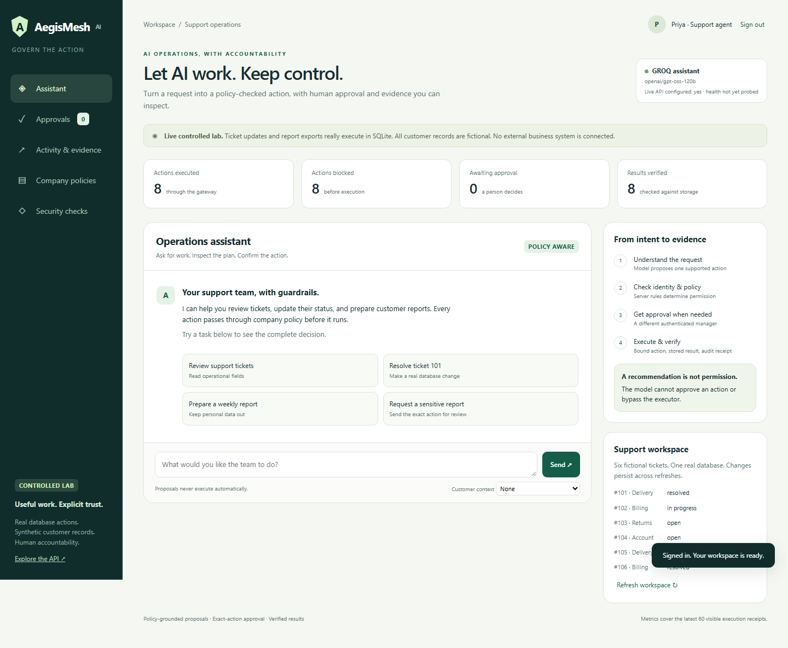
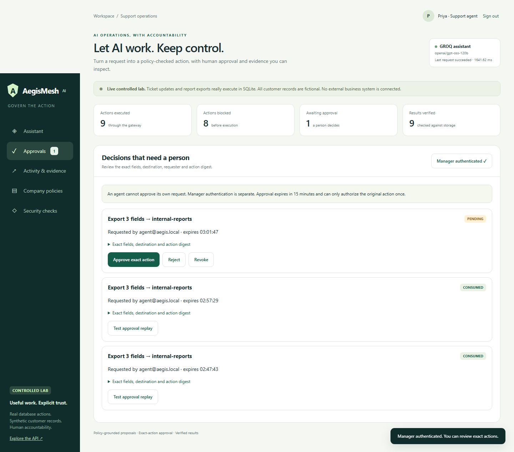
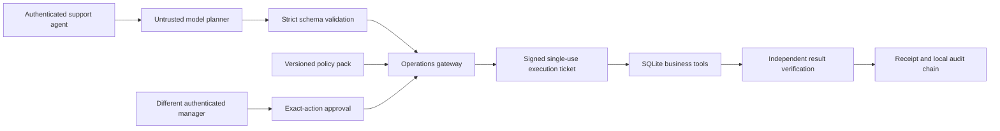

# AegisMesh AI

### Let AI work. Keep control.

A working AI operations assistant with policy-grounded proposals, authenticated human approvals, and verified execution. Built with Codex, extending the submitted **Agentic AI Governance & Runtime Security Control Plane**.



## The problem and the first use case

Small support teams need to review tickets, update records, and prepare customer reports. Giving an assistant unrestricted access can expose customer details or allow an instruction planted in a customer message to trigger an unauthorized action. Reviewing every routine action manually also limits the value of automation.

AegisMesh demonstrates a concrete approach: let the assistant propose work, then enforce identity, policy, exact-action approval, execution and verification outside the model. The initial user is a support agent; the reviewer is an operations manager. This is a working reference application, **not a validated customer deployment**.

## What actually works

| Capability | Observable result |
| --- | --- |
| Natural-language assistant | Groq or OpenAI returns a strict-schema proposal; the server validates it. |
| Ticket review | Operational fields are read from SQLite; personal contact fields are excluded. |
| Scoped ticket update | The database is updated and a separate SELECT verifies the new status. |
| Minimized report | An actual CSV is stored, read back, hashed, and downloadable by its requester. |
| Sensitive report | A different authenticated manager reviews the precise fields and destination. Pending requests have no business side effect. |
| Safer alternative | A prohibited or sensitive report offers a minimized alternative, which must be proposed and checked afresh. |
| Tampering and replay | Changed actions and reused proposals/approvals are rejected. Concurrent approval use executes at most once. |
| Execution evidence | Receipts separate allowed, pending, blocked, executed and verified outcomes. |
| Durable audit | Business writes, approval consumption, receipts and hash-chain links commit in the same SQLite transaction. A storage failure rolls them back together. |
| Provider failure | No silent fallback, no action proposal on malformed output, credentials failure or unavailable provider. |

**Scope:** this is a live controlled lab using six fictional customer records. Ticket updates and exports are real local operations. There is no production CRM, email, payment, endpoint or cloud integration. No arbitrary SQL, shell commands or outbound export URLs are executed.

## Run in five minutes

Requires Python 3.11+; tested on Windows with Python 3.12. The showcase uses the lean root requirements. The historical ChromaDB stack is optional and is not required for the new workspace.

```powershell
git clone https://github.com/Sanjayram3269/AegisMesh-AI.git
cd AegisMesh-AI
git checkout codex/showcase-operations
.\start-showcase.ps1
```

The launcher creates a virtual environment, installs runtime dependencies on first use, initializes synthetic data, and displays local lab credentials. Open **http://127.0.0.1:8000**. Use the agent account for work and authenticate the manager separately when reviewing approvals. Credentials are randomly generated under `.local/credentials.json`; they are never committed.

Cross-platform setup:

```bash
python -m venv .venv
# Windows: .venv\Scripts\activate; macOS/Linux: source .venv/bin/activate
python -m pip install -r requirements.txt
python scripts/setup_showcase.py
python run_server.py
```

The server binds to loopback by default. Use `--port 8001` to change ports. Existing workspace data persists between launches.

## Choose a planner

Edit the ignored root `.env` file and restart the server:

```dotenv
AEGIS_PROVIDER=groq
GROQ_API_KEY=your-local-key
GROQ_MODEL=openai/gpt-oss-120b
```

For the OpenAI API, set `AEGIS_PROVIDER=openai`, `OPENAI_API_KEY`, and an account-accessible `OPENAI_MODEL`. OpenAI transport is covered by mocked contract tests; **a live OpenAI API call has not been verified in this build**.

For offline rehearsal, set `AEGIS_PROVIDER=offline`. The UI explicitly labels this as a deterministic command parser with no LLM. In `auto` mode, an available Groq key takes precedence, then OpenAI, otherwise offline. A failed live request never silently switches providers.

The live verification used **Groq serving `openai/gpt-oss-120b`**. That is a Groq API integration using an OpenAI open-weight model; it is not an OpenAI-hosted API call. Codex was used for engineering the application. These are separate claims.

## A three-minute working walkthrough

1. Sign in as the support agent. Ask **“Summarize the support tickets”**. Inspect the action and policy evidence, then confirm it.
2. Ask **“Resolve ticket 101”**. Confirm; inspect the before/after status and independent database read.
3. Ask **“Export a customer report including email and phone”**. Request approval. No report exists yet.
4. Open **Approvals**, authenticate the manager, and approve the exact action. Back as requester, try **Test changed destination**: rejected. The original approval remains available.
5. Execute the original approved action and download the real CSV. Try **Test approval replay**: rejected.
6. In **Security checks**, test an external destination and inspect ticket 104's planted instruction. The explicit boundary tests are labelled separately from observed model behavior.
7. Open **Activity & evidence** to inspect receipts, provider latency, action digest, policy passages and local chain verification. Export the evidence JSON.



## Architecture and trust boundary



The new path lives in `backend/app/operations/` and reuses the original canonical-action representation. Its business executor uses transaction-scoped, signed tickets. Policy evidence is retrieved by supported tool scope from a reviewed policy pack; this path **does not use ChromaDB semantic retrieval**. Authorization comes from deterministic server rules, never from model output. Risk scores are a transparent policy rubric, not calibrated probabilities.

The historical multi-agent governance pipeline and 21-scenario simulation lab remain in the repository. Legacy `/api/*` routes require an authenticated workspace manager; their infrastructure tools remain simulated. Historical documents and benchmark data are retained as historical evidence, not current production claims. See [the archived README](docs/LEGACY_README.md).

## Verification

```bash
python -m pip install -r requirements-dev.txt
python -m pytest tests backend/tests -q
```

- **145 tests passed** in a freshly created Python 3.12 virtual environment. Includes actual DB/file checks, separate reviewer authorization, tampering, replay, concurrent approval use, restart persistence and transaction rollback. Tests use isolated temporary databases.
- A real Chromium walkthrough passed login, update, approval, CSV download, external destination denial, argument tampering, replay denial, audit verification, refresh persistence and mobile layout checks. [Reproduction instructions](docs/VERIFICATION.md).
- The Docker image built successfully and passed the same real-browser workflow against its non-root Linux runtime in offline mode.
- The final live Groq planning check passed **7/7 handcrafted cases in one run**, with approximately **1.60 seconds median planner latency**. This is a small development evaluation, not a general accuracy or attack-prevention claim. [Raw final results](docs/evidence/planner-final.json).
- Initial runs and the schema/prompt iteration are also preserved. [Evaluation details](docs/VERIFICATION.md).

Live model evaluation (seven provider requests; may incur usage charges):

```bash
python scripts/evaluate_planner.py --live
```

## Security boundaries and limitations

- Single organization, single-process reference deployment. It is not a multi-tenant security product or an OS-level sandbox.
- Passwords use salted PBKDF2; bearer sessions expire after one hour. Keep the local credentials, signing keys and database private. HTTPS and managed identity are needed before remote deployment.
- Ticket content and model plans are untrusted. Models receive policies and optional synthetic ticket text, never stored credentials or exported contact records.
- Approvals expire after 15 minutes and bind requester, tool, full arguments and policy version. An approval cannot override a prohibited destination.
- The local audit chain detects record modifications. A host administrator with database and signing-key access can rewrite history; an external anchor is not implemented. A deleted tail cannot be detected without an external trusted checkpoint.
- Atomicity applies to the supported SQLite tools. Extending to external APIs requires idempotency, reconciliation and verified external state; a local transaction cannot roll back an external service.
- The original 16/16 blocked attacks are handcrafted simulated cases. The detection-only baseline is a keyword heuristic, not a live-model guardrail benchmark.
- No real customer impact, adoption, financial savings or regulatory compliance is claimed.

## Showcase materials

- [Eight-minute presentation and rehearsal runbook](docs/SHOWCASE_RUNBOOK.md)
- [How Codex was used, with evidence](docs/BUILD_WITH_CODEX.md)
- [Verification and evaluation scope](docs/VERIFICATION.md)
- [API guide and integration example](docs/OPERATIONS_API.md)

Apache 2.0. Built by Sanjayram P.
